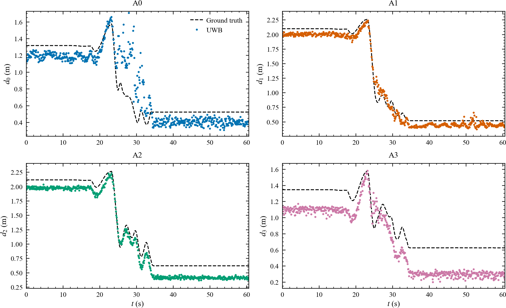
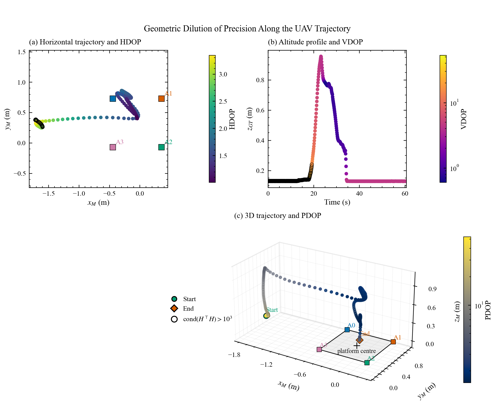

# 基于动捕真值的 UWB 四基站测距与三维定位精度评估


用 **动捕（motion capture）** 作为真值，系统评估 Nooploop LinkTrack UWB 的
四基站测距精度、三维定位精度、原始数据质量，以及测距误差与定位误差之间的关系。
面向论文写作：所有图使用 `science + ieee + no-latex` 样式，同时输出 300 dpi PNG 与 PDF 矢量图。

> **一句话**：把 5 个 ROS bag 导出的 CSV 放进 `data/raw/`，运行一条命令，得到 32 张论文图、18 张统计表、逐帧数据和一份 Markdown 分析报告。

---

## 目录

- [1. 项目简介](#1-项目简介)
- [2. 主要特性](#2-主要特性)
- [3. 目录结构](#3-目录结构)
- [4. 环境要求与安装](#4-环境要求与安装)
- [5. 数据准备](#5-数据准备)
- [6. 快速开始](#6-快速开始)
- [7. 配置说明](#7-配置说明)
- [8. 输出说明](#8-输出说明)
- [9. 方法说明](#9-方法说明)
- [10. 结果摘要](#10-结果摘要)
- [11. 测试](#11-测试)
- [12. 常见问题](#12-常见问题)
- [13. 引用与许可](#13-引用与许可)
- [14. 上传到 GitHub](#14-上传到-github)

---

## 1. 项目简介

UWB 在无人机上的精度评估通常缺少独立真值，或者把定位结果与自身测距混为一谈。
本项目用两路动捕数据（无人机位姿 + 降落平台中心）构造真值，分离评估：

| 实验 | 评估对象 | 核心指标 |
|---|---|---|
| 实验一 | 四基站**测距** | 每站 RMSE / MAE / Bias / Std / Max / P95 / 有效率 / 跳变次数 |
| 实验二 | UWB **三维定位** | 三轴、水平、三维 RMSE / Bias / P95，以及尺度失配诊断 |
| 数据质量 | 原始输出 | 采样率、丢包、位置跳变、固定值段、EOP、Z 轴异常 |
| 联合分析 | 测距 ↔ 定位 | 相关系数、几何 DOP、蒙特卡洛校验 |

适用场景：UWB 选型对比、基站布局评估、定位算法调试、论文实验章节。

## 2. 主要特性

- **真值可靠**：动捕 >100 Hz，UWB 10 Hz，按 `bag_time_sec` 插值对齐，不按行号匹配。
- **几何自检**：自动检查基站间距（0.8 m）、对角线（1.1314 m）、共面性、顺/逆时针顺序。
- **不"美化"数据**：不做配准、尺度修正、姿态标定；系统性失配如实报告并给出诊断，不修改原始值。
- **论文级出图**：IEEE 双栏/单栏尺寸，Times 字体，PNG 300 dpi + PDF 矢量，色盲友好配色。
- **DOP 分析**：HDOP / VDOP / PDOP 由同一几何雅可比计算，附条件数与蒙特卡洛校验。
- **可复现**：一键 `batch_analysis.py`，配套 21 项单元/端到端测试与 Markdown 报告。

## 3. 目录结构

```text
uwb_mocap_analysis/
├── configs/
│   └── config.yaml              # 数据路径、基站几何、坐标映射、阈值
├── data/raw/                    # 5 份原始 CSV（见第 5 节）
├── src/
│   ├── data_loader.py           # 读取 + 时间对齐 + 统一数据集
│   ├── time_alignment.py        # 公共时间窗、带间隙检测的插值
│   ├── coordinate_transform.py  # UWB → MAVROS 已知轴映射
│   ├── anchor_geometry.py       # 四基站几何与自检
│   ├── ground_truth_ranges.py   # 测距真值、dis_arr 对应关系核对
│   ├── ranging_metrics.py       # 测距指标
│   ├── localization_metrics.py  # 定位指标 + 尺度诊断
│   ├── uwb_quality.py           # 采样/跳变/固定值/EOP/Z 轴质量
│   ├── joint_analysis.py        # 联合表、相关性、DOP
│   ├── plot_style.py            # IEEE 样式与导出
│   └── plots_{ranging,localization,quality,joint}.py
├── scripts/
│   ├── inspect_data.py          # 数据/几何/时间同步检查
│   ├── evaluate_ranging.py      # 实验一 + R1–R9
│   ├── evaluate_localization.py # 实验二 + P1–P12
│   ├── analyze_uwb_quality.py   # 数据质量 + Q1–Q4
│   ├── analyze_joint_errors.py  # 联合分析 + J1–J7
│   ├── verify_dop.py            # DOP 专项校验 + J6
│   └── batch_analysis.py        # 一键全流程 + 报告
├── tests/                       # 21 项单元/端到端测试
├── results/                     # 运行后自动生成
│   ├── figures/{ranging,localization,quality,joint}/
│   ├── tables/
│   ├── processed_csv/
│   └── reports/
├── requirements.txt
└── README.md
```

## 4. 环境要求与安装

- Python ≥ 3.9（开发环境 3.10）
- numpy / pandas / scipy / matplotlib / SciencePlots / PyYAML / pytest

```bash
git clone https://github.com/<your-name>/<repo-name>.git
cd <repo-name>

# 方式一：conda
conda create -n uwb-mocap python=3.10 -y
conda activate uwb-mocap
pip install -r requirements.txt

# 方式二：venv
python -m venv .venv
# Windows
.venv\Scripts\activate
# Linux / macOS
source .venv/bin/activate
pip install -r requirements.txt
```

> Windows 下建议使用 Windows Terminal 或 PowerShell 7；旧版控制台若出现中文乱码，
> 执行 `chcp 65001`，脚本内部已把 stdout 设为 UTF-8。

## 5. 数据准备

把 ROS bag 导出的 5 个 CSV 放到 `data/raw/`，并在 `configs/config.yaml` 的
`data.files` 中对应文件名。默认文件如下：

| 文件 | 来源话题 | 用途 | 必需 |
|---|---|---|---|
| `uav_mocap.csv` | `mavros/vision_pose/pose` | 无人机真值位姿 | ✅ |
| `platform_mocap.csv` | `natnet_ros_ljp_pose` | 降落平台中心（静止） | ✅ |
| `uwb_tagframe0.csv` | `nlink_linktrack_tagframe0` | UWB 位置、EOP、四站测距 | ✅ |
| `px4_local_position.csv` | `mavros/local_position/pose` | 仅用于合理性核对 | 可选 |
| `px4_setpoint_position.csv` | `mavros/setpoint_position/local` | 不参与本次分析 | 可选 |

**列名要求**（脚本按列名读取，不依赖列顺序）：

- 动捕类：`bag_time_sec`、`pose.position.x/y/z`（`header.frame_id` 可选）
- UWB：`bag_time_sec`（或 `relative_time_sec`）、`pos_3d[0..2]`、`eop_3d[0..2]`、`dis_arr[0..3]`
- 时间列优先 `bag_time_sec`（秒）；动捕与 UWB 必须能落到同一时间轴。

**坐标系与几何约定**：

- 平台局部 UWB 坐标系：原点在平台中心，X 右、Y 前、Z 垂直平台面；四基站 A0→A3 顺时针。
- 已知轴映射（写死在配置里）：`x_M = y_U, y_M = −x_U, z_M = −z_U`。
- 平台尺寸 0.8 m × 0.8 m，基站位于四角；如需修改，改 `geometry.anchors_uwb` 与 `geometry.side_m`。

**换一份数据**：替换 `data/raw/` 五个 CSV → 修改 `configs/config.yaml` 的 `project.bag` 与
`data.files` → 重跑 `batch_analysis.py` 即可，无需改代码。

## 6. 快速开始

### 一键跑完全部

```bash
python scripts/batch_analysis.py --config configs/config.yaml
```

约 20–30 s，终端会依次打印数据检查、测距、定位、质量、联合分析、DOP 校验的结果，
最后输出报告路径 `results/reports/analysis_report.md`。

### 分步运行（只关心某一部分时）

```bash
python scripts/inspect_data.py          --config configs/config.yaml   # 列名/单位/时间戳/几何检查
python scripts/evaluate_ranging.py      --config configs/config.yaml   # 测距精度 + R1–R9
python scripts/evaluate_localization.py --config configs/config.yaml   # 定位精度 + P1–P12
python scripts/analyze_uwb_quality.py   --config configs/config.yaml   # 数据质量 + Q1–Q4
python scripts/analyze_joint_errors.py  --config configs/config.yaml   # 联合分析 + J1–J7
python scripts/verify_dop.py            --config configs/config.yaml   # DOP 校验 + J6
```

## 7. 配置说明

`configs/config.yaml` 主要字段：

| 字段 | 含义 | 默认 |
|---|---|---|
| `project.bag` | 数据集名称（写进报告） | `..._17138_...` |
| `data.raw_dir` | 原始 CSV 目录 | `data/raw` |
| `data.files.*` | 五个 CSV 的文件名 | 见第 5 节 |
| `geometry.side_m` | 平台边长 / 基站间距 (m) | `0.8` |
| `geometry.anchors_uwb` | 四基站平台局部坐标 (4×3) | `(±0.4, ±0.4, 0)` |
| `geometry.uwb_to_mavros` | 已知轴映射矩阵 | `[[0,1,0],[-1,0,0],[0,0,-1]]` |
| `time.max_gap_s` | 插值允许的最大间隙 (s) | `0.5` |
| `quality.range_min_m/max_m` | 有效测距范围 | `0.05 / 20` |
| `quality.range_jump_m` | 测距跳变阈值 (m) | `0.5` |
| `quality.pos_jump_m` | 位置跳变阈值 (m) | `0.3` |
| `quality.stuck_min_run` | 固定值最短帧数 | `10` |
| `metrics.percentile` | 分位数 | `95` |
| `plots.dpi` | PNG 分辨率 | `300` |
| `plots.formats` | 输出格式 | `[png, pdf]` |
| `output.results_dir` | 结果目录 | `results` |

## 8. 输出说明

运行后 `results/` 结构：

```text
results/
├── figures/
│   ├── ranging/         R1–R9    测距对比、误差时序、RMSE 柱状、箱线、CDF、误差-距离、2D/3D 布局、异常
│   ├── localization/    P1–P12   原始/转换 XYZ、XY/3D 轨迹、真值对比、三轴误差、水平/3D 误差、RMSE、CDF、箱线
│   ├── quality/         Q1–Q4    采样间隔、位置跳变、高度异常统一时间轴、EOP 与 Z 轴固定段
│   └── joint/           J1–J7    测距-定位时序、散点、相关热图、DOP 三子图、DOP 校验、VDOP–高度
├── tables/              18 个统计表（CSV/JSON）
├── processed_csv/       9 个逐帧数据（对齐、误差、DOP、联合表）
└── reports/
    ├── analysis_report.md     汇总报告（含全部图索引）
    ├── data_inspection.md     数据检查报告
    ├── dop_verification.md    DOP 专项校验
    ├── figure_captions.md     论文图注（可直接使用）
    └── summary.json           关键指标 JSON
```

所有图片同时输出 `.png`（300 dpi）与 `.pdf`（矢量，字体嵌入）。

**关键图**：

| 图 | 内容 |
|---|---|
| `R1_ranges_vs_truth` | 四站实测距离 vs 动捕真值 |
| `P5_compare_xyz` | UWB vs 真值三轴对比（可直接看出尺度问题） |
| `Q3_height_timeline` | 高度异常统一时间轴（UWB z / 真值 / EOP / 测距误差 / z 误差） |
| `J5_geometry_dop` | 水平 HDOP、垂直 VDOP、三维 PDOP 三子图 |
| `J6_dop_validation` | 线性 DOP 与蒙特卡洛的对比 |

## 9. 方法说明

### 9.1 坐标与基站

平台中心取 `natnet` 有效样本中位数（静止平台，标准差应接近 0）。
四基站在 UWB 系为 `(±0.4, ±0.4, 0)`，乘以映射矩阵后加平台中心，得到动捕世界系坐标。

自动检查：相邻间距 0.8 m、对角 1.1314 m、z 展布 0、俯视顺时针（有向面积为负）。

### 9.2 时间同步

以 UWB 的 `bag_time_sec` 为主时钟，把高频动捕真值线性插值到每个 UWB 时刻：

- 不使用 CSV 行号；
- 只在两路数据的公共时间窗内插值，不外推；
- 跨越超过 `max_gap_s` 的插值标记为无效并在统计中剔除。

### 9.3 测距真值与误差

$$d_i^{GT}(t)=\lVert p_{UAV}(t)-a_i\rVert,\qquad e_i(t)=d_i^{UWB}(t)-d_i^{GT}(t)$$

假设 TAG 参考点与无人机动捕点重合（忽略安装偏移），不做姿态旋转。

### 9.4 定位误差

$$p_{rel}(t)=p_{UAV}(t)-p_{platform},\qquad e(t)=p_{UWB}^{M}(t)-p_{rel}(t)$$

**不做任何配准或缩放**。若两路坐标原点不一致，脚本会通过"落地后无人机应位于平台中心"
这一物理约束报告异常，而不是平移数据去凑。

### 9.5 DOP

对每个样本用四基站真实坐标与无人机真实位置构造测距雅可比
$H_i=(p-a_i)/\lVert p-a_i\rVert$，令 $G=(H^\top H)^{-1}$：

$$\mathrm{HDOP}=\sqrt{G_{xx}+G_{yy}},\quad
\mathrm{VDOP}=\sqrt{G_{zz}},\quad
\mathrm{PDOP}=\sqrt{\mathrm{tr}(G)}$$

因此恒有 $\mathrm{PDOP}^2=\mathrm{HDOP}^2+\mathrm{VDOP}^2$。
代码同时输出 $\mathrm{rank}(H)$ 与 $\mathrm{cond}(H^\top H)$，几何退化样本（默认
`cond > 1e3`）在图中用黑圈标出。

> DOP 是**线性化**指标：几何病态时（例如远离阵列且贴近基站平面）它会显著高估实际误差。
> 项目附蒙特卡洛校验图（J6）说明这一点，论文中建议把 DOP 作为"几何条件相对指标"。

### 9.6 联合分析

把逐帧测距误差与定位误差对齐后计算 Pearson/Spearman 相关系数，并用真实几何计算
HDOP/VDOP/PDOP。相关性只描述统计关联，不据此推断因果。

## 10. 结果摘要

以仓库自带数据（`bag 17138`，60.6 s，UWB 607 帧 @10 Hz，动捕 117 Hz）为例。

**测距精度**

| 基站 | RMSE (m) | MAE (m) | Bias (m) | P95 (m) | 有效率 |
|---|---|---|---|---|---|
| A0 | 0.260 | 0.164 | −0.023 | 0.464 | 100% |
| A1 | 0.098 | 0.088 | −0.066 | 0.144 | 100% |
| A2 | 0.171 | 0.163 | −0.161 | 0.228 | 100% |
| A3 | 0.277 | 0.265 | −0.254 | 0.374 | 100% |
| **合并** | **0.214** | — | **−0.126** | 0.350 | 100% |

**定位精度（直接比较，未修正）**：RMSE X 1.685 m、Y 0.303 m、Z 0.241 m、**3D 1.729 m**。

**关键发现**：UWB 位置输出存在**系统性比例失配**——逐轴回归
`truth ≈ k·uwb + b`，X 轴 k = 0.378（UWB 被放大约 **2.64 倍**，r² = 0.988），
Z 轴 k = 1.011（正常）。米级 RMSE 主要来自该失配，而非随机噪声；
项目如实报告、不做缩放修正，建议在 UWB 基站坐标/单位配置侧排查。

**几何**：HDOP 中位 1.34，VDOP 中位 4.48，PDOP 中位 4.60；四基站共面导致垂直几何条件差。

**数据质量**：10.00 Hz、无丢包；位置跳变 30 次；Z 轴固定值占 40.7%；EOP 含义待确认。




## 11. 测试

```bash
python -m pytest tests -q -p no:cacheprovider
# 21 passed
```

覆盖：坐标变换正交性、基站几何（0.8 / 1.1314 / 共面 / 顺序）、测距真值、
指标计算、跳变检测、时间插值与间隙、DOP 共面弱几何、真实数据端到端管线。

## 12. 常见问题

**Q1. 终端中文/符号乱码？**
脚本启动时已把 stdout 设为 UTF-8；若仍乱码，`chcp 65001` 或改用 Windows Terminal。

**Q2. 目录里出现 `pytest-cache-files-*`？**
pytest 缓存目录被权限挡住时的退路。用 `-p no:cacheprovider` 运行即可避免，可直接删除。

**Q3. 3D 图的 z 轴标签被裁掉？**
`plot_style.save_figure` 已合并所有文本包围盒并对 3D 文本做了范围钳制；自定义图仍出现时，
可调大 `pad_inches` 或检查是否绕过了 `save_figure`。

**Q4. 定位 RMSE 有 1.7 m，是代码错了吗？**
不是。见第 10 节的比例失配诊断（X 轴 2.64 倍）。脚本没有做任何"修正"。

**Q5. VDOP 出现 50 多，正常吗？**
正常。远离阵列且贴近基站平面时垂直方向几乎不可观测，`cond(HᵀH)` 可达 1e4；
J6/J7 给出了解释和蒙特卡洛校验。

**Q6. 想换一份飞行数据？**
替换 `data/raw/` 五个 CSV，改 `config.yaml` 的文件名与 `project.bag`，重跑即可。

**Q7. 只想重画某一张图？**
单独运行对应脚本（第 6 节），只重算该部分；图会覆盖 `results/figures/` 下同名文件。

**Q8. 能处理别的平台尺寸吗？**
可以，改 `geometry.anchors_uwb`（保持 4×3 与顺时针）和 `geometry.side_m`。

## 13. 引用与许可

若本项目对你有帮助，欢迎在论文中引用或致谢；也可参考 `results/reports/figure_captions.md`
中的图注写法。

代码采用 [MIT License](LICENSE)。数据和实验记录归原作者所有，使用前请确认授权。

