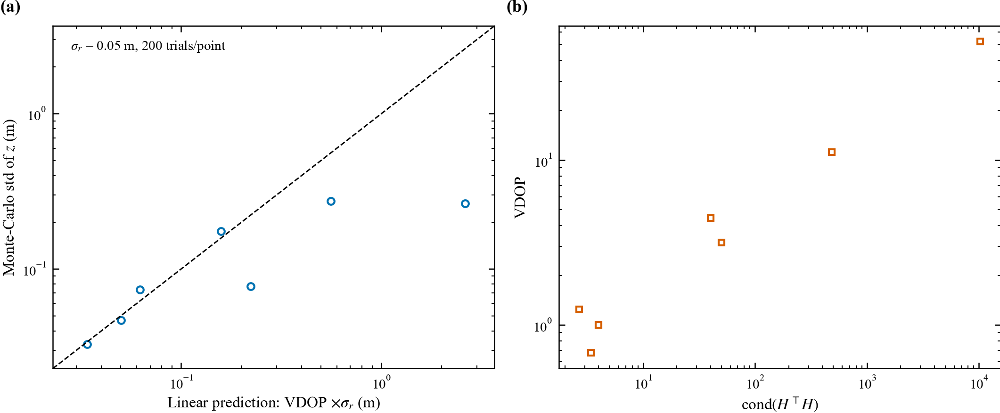

# DOP 校验报告（J5 / J6）

## 1. 基站坐标与几何

- 四基站世界坐标（m）：
  - A0: (-0.4466, +0.7302, +0.0655)
  - A1: (+0.3534, +0.7302, +0.0655)
  - A2: (+0.3534, -0.0698, +0.0655)
  - A3: (-0.4466, -0.0698, +0.0655)
- 相邻间距 [0.8, 0.8, 0.8, 0.8] m，对角 [1.1314, 1.1314] m，高度展布 0.00e+00 m（共面）
- 平台中心 z = 0.0655 m；无人机绝对 z ∈ [0.128, 0.956] m，相对平台面高度 z ∈ [0.062, 0.891] m

## 2. 公式与实现

- 雅可比：$H_i = (p - a_i)/\Vert p - a_i\Vert$，$G = (H^{\top}H)^{-1}$
- HDOP $=\sqrt{G_{xx}+G_{yy}}$，VDOP $=\sqrt{G_{zz}}$，GDOP $=\sqrt{\mathrm{tr}(G)}$
- 逐点交叉验证：GDOP 与 $\sqrt{HDOP^2+VDOP^2}$ 的最大偏差 0.00e+00

## 3. 条件数与分支

- 全轨迹 cond$(H^TH)$ 中位 40.3，最大 10570.7
- 起飞前（远处、贴地）：cond$(H)$=101.5，VDOP=52.4
- 阵列上方（z≈0.7 m）：VDOP=0.68

分支统计（按水平距离与高度分箱）：

| distance_bin_m | z_bin_m | n | vdop_median | vdop_min | vdop_max |
|---|---|---|---|---|---|
| 0.0-0.3 | 0.00-0.15 | 264 | 4.472 | 2.527 | 4.520 |
| 0.0-0.3 | 0.15-0.30 | 9 | 1.163 | 1.115 | 1.802 |
| 0.0-0.3 | 0.30-0.60 | 14 | 0.991 | 0.948 | 1.023 |
| 0.0-0.3 | 0.60-1.00 | 11 | 0.659 | 0.645 | 0.715 |
| 0.3-0.6 | 0.15-0.30 | 6 | 1.080 | 1.074 | 1.092 |
| 0.3-0.6 | 0.30-0.60 | 29 | 0.975 | 0.865 | 1.071 |
| 0.3-0.6 | 0.60-1.00 | 25 | 0.916 | 0.734 | 1.019 |
| 0.6-1.0 | 0.60-1.00 | 5 | 1.476 | 1.080 | 1.991 |
| 1.0-1.4 | 0.60-1.00 | 5 | 2.875 | 2.278 | 3.430 |
| 1.4-2.0 | 0.00-0.15 | 190 | 52.372 | 20.990 | 53.069 |
| 1.4-2.0 | 0.15-0.30 | 12 | 13.722 | 10.681 | 19.557 |
| 1.4-2.0 | 0.30-0.60 | 13 | 7.708 | 6.048 | 10.164 |
| 1.4-2.0 | 0.60-1.00 | 24 | 4.511 | 3.660 | 5.839 |

## 4. 蒙特卡洛校验（σ_r = 0.05 m，200 次/点）

| t_s | x_m | y_m | z_m | dist_xy_m | vdop | vdop_x_sigma | mc_std_z | cond_HtH |
|---|---|---|---|---|---|---|---|---|
| 0.000 | -1.667 | 0.048 | 0.065 | 1.668 | 52.410 | 2.620 | 0.265 | 10309.454 |
| 20.000 | -1.586 | -0.076 | 0.278 | 1.587 | 11.191 | 0.560 | 0.273 | 482.083 |
| 24.001 | -1.300 | 0.049 | 0.763 | 1.300 | 3.158 | 0.158 | 0.176 | 49.954 |
| 26.001 | -0.006 | 0.196 | 0.697 | 0.196 | 0.678 | 0.034 | 0.033 | 3.425 |
| 30.001 | -0.323 | 0.455 | 0.415 | 0.558 | 1.003 | 0.050 | 0.047 | 4.008 |
| 34.001 | -0.013 | 0.124 | 0.245 | 0.125 | 1.244 | 0.062 | 0.074 | 2.682 |
| 60.600 | 0.004 | 0.074 | 0.063 | 0.074 | 4.462 | 0.223 | 0.078 | 39.953 |

结论：线性化 DOP 与蒙特卡洛在良态几何（阵列上方）一致；
在病态几何（远处 + 贴地，cond≈1e4）线性 DOP 会显著高估实际垂直散布，
因此 VDOP 只能作为几何条件的相对指标，不应直接乘 σ 当作绝对误差。

